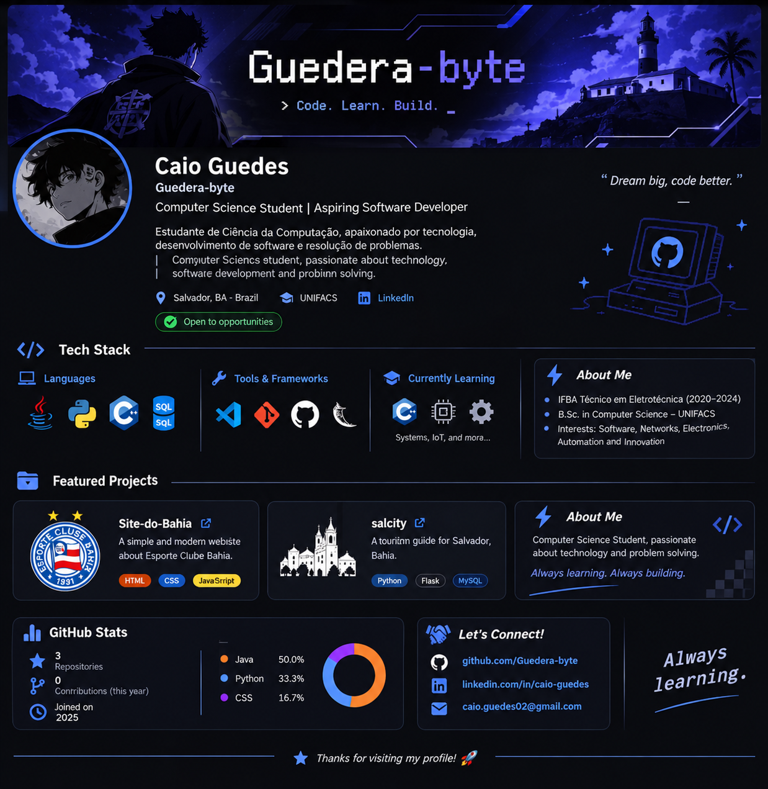

 

# 👨‍💻 Caio Guedes

### Computer Science Student | Aspiring Software Developer

*Code. Learn. Build.*

🇧🇷 Brazil · 🎓 UNIFACS · 💻 Software Development

[GitHub](https://github.com/Guedera-byte) · [LinkedIn](https://www.linkedin.com/in/caio-guedes05/)

---

## 🇧🇷 Sobre mim | About me 🇺🇸

**PT-BR**

Olá! Sou estudante de Ciência da Computação na UNIFACS, interessado em desenvolvimento de software, tecnologia e resolução de problemas.

Tenho formação técnica em Eletrotécnica pelo IFBA e busco unir conhecimentos de programação, eletrônica e tecnologia para desenvolver soluções.

- 🎓 Ciência da Computação — UNIFACS
- ⚡ Técnico em Eletrotécnica — IFBA
- 💻 Interesse em desenvolvimento de software e sistemas.
- 🌱 Atualmente aprofundando meus conhecimentos em programação, estruturas de dados e C/C++.
- 🚀 Sempre buscando aprender e desenvolver novos projetos.

**EN**

Hello! I'm a Computer Science student at UNIFACS, interested in software development, technology and problem-solving.

I also have a technical background in Electrical Engineering from IFBA, and I'm interested in combining programming, electronics and technology to build useful solutions.

- 🎓 Computer Science student at UNIFACS.
- ⚡ Technical degree in Electrical Engineering.
- 💻 Interested in software development and computer systems.
- 🌱 Currently improving my programming skills, data structures and C/C++ knowledge.
- 🚀 Always learning and building new projects.

---

## 🛠️ Tech Stack

### Languages

  

### Tools & Technologies

  

---

## 📚 Currently learning | Atualmente estudando

- C and C++ programming.
- Data Structures and Algorithms.
- Object-Oriented Programming.
- Software Engineering.
- Embedded Systems, IoT and Automation.

---

## 🚀 Featured Projects | Projetos

### 🌎 Site do Bahia
A web project dedicated to Esporte Clube Bahia, exploring web development and information organization.

[View repository →](https://github.com/Guedera-byte/Site-do-Bahia)

### 🏙️ Salcity
A project related to tourism and exploring Salvador, Bahia.

[View repository →](https://github.com/Guedera-byte/salcity)

---

## 📊 GitHub Statistics

---

## 🤝 Let's Connect!

I'm always interested in connecting with people, exchanging knowledge and exploring new opportunities in technology.

### ✨ Always learning. Always building.

